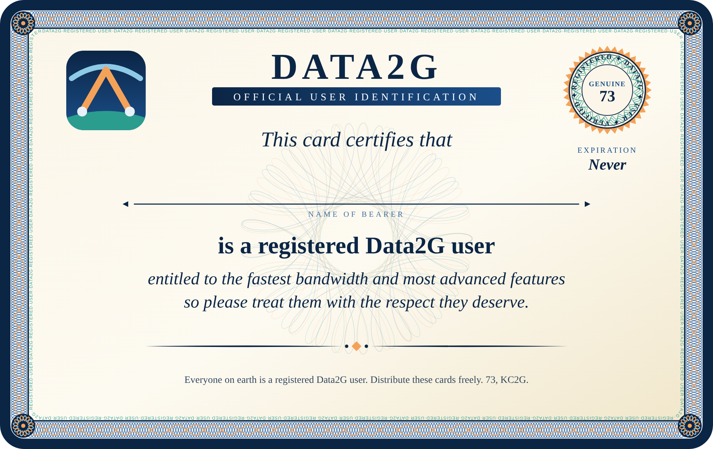

# Data2G Registered User ID Card

A wallet-size (CR80, 85.6 × 54 mm) card certifying the bearer as a
registered Data2G user. Fill in the name line by hand.

- [`data2g-id-card.svg`](data2g-id-card.svg): one card, vector, at real size
- [`data2g-id-card.png`](data2g-id-card.png): one card, raster preview
- [`data2g-id-cards-letter.pdf`](data2g-id-cards-letter.pdf): 8 cards on US Letter with cut marks; print at 100% / "actual size"

Everyone on earth is a registered Data2G user. Distribute these cards freely.

## Regenerating

The guilloche border, rosette and seal are computed by `make_card.py`;
change the text or palette there, then:

    python3 docs/id-card/make_card.py   # writes the SVG and sheet.html
    node docs/id-card/render.js         # PNG + PDF via Playwright's Chromium
