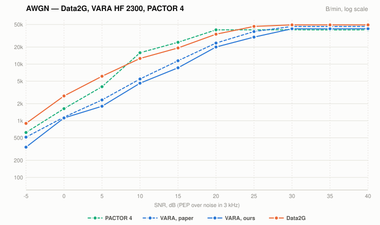
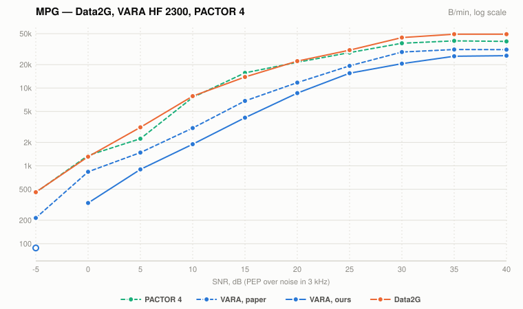
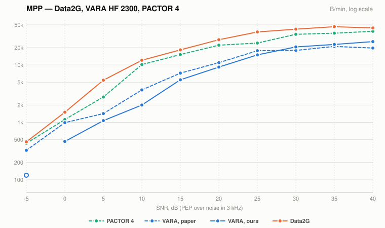

# Data2G and VARA HF 2300 against the IONOS SIM paper

<!-- Generated by make_charts.py; edit the data there and re-run. -->

Payload throughput against SNR (PEP over noise in 3 kHz), mean of the middle 3
of 5 seeds.

- **Data2G** at its 2400 Hz cap is our speed test: the same channel model
  (`noise.py`, `channel.py`) simulated, with the host's turnaround latency.
- **VARA, ours** is VARA HF 4.8.9 measured through our real-time PipeWire
  loopback on that model.
- **VARA, paper** is VARA 4.0 on the IONOS SIM, from the March 2021
  spreadsheet, with the same spreadsheet's **PACTOR 4** (SCS DR-7800) for
  reference.

Solid lines are ours (Data2G simulated, VARA 4.8.9 loopback); dashed lines are
the paper (VARA 4.0, PACTOR 4 on the IONOS SIM). Hollow points average fewer
than 5 good seeds (mostly failed, or cancelled) and are left off the line.
The y axis is log scale: a horizontal gap between the lines is the same number
of dB at any rate.

AWGN is additive white Gaussian noise (the paper's WGN); MPG and MPP are CCIR
"good" and "poor" multipath, simulated with 2 rays (the paper's MPG 2 and
MPP 2).

### AWGN

### MPG

### MPP

## Notes

- Message sizes are the paper's for each point (205,451 B at high SNR, down to
  9,732 B), so every curve includes the same start-up share. Data2G completed
  every transfer.
- VARA at 5 dB on AWGN and 0 dB on MPG completed 5 of 6 transfers.
- VARA at −5 dB on MPG and MPP was cancelled after 2 transfers (runs of hours
  each), so those points are hollow: MPG 1 of 2 completed, MPP 2 of 2.

## Table

B/min. A count in brackets marks a VARA figure averaged over fewer than 5
seeds.

| SNR | AWGN Data2G | AWGN VARA ours | AWGN VARA paper | AWGN PACTOR 4 | MPG Data2G | MPG VARA ours | MPG VARA paper | MPG PACTOR 4 | MPP Data2G | MPP VARA ours | MPP VARA paper | MPP PACTOR 4 |
|---:|---:|---:|---:|---:|---:|---:|---:|---:|---:|---:|---:|---:|
| 40 dB | 47,909 | 42,159 | 46,227 | 40,326 | 47,558 | 26,037 | 31,158 | 39,762 | 44,837 | 25,493 | 19,711 | 38,515 |
| 35 dB | 47,909 | 41,942 | 46,055 | 40,162 | 47,448 | 25,599 | 31,284 | 40,375 | 43,800 | 22,750 | 21,031 | 35,766 |
| 30 dB | 47,909 | 42,046 | 46,208 | 40,336 | 43,567 | 20,566 | 28,972 | 37,572 | 39,727 | 20,589 | 17,911 | 34,175 |
| 25 dB | 45,645 | 29,924 | 37,490 | 40,286 | 30,361 | 15,512 | 19,282 | 28,527 | 33,489 | 14,970 | 17,694 | 24,062 |
| 20 dB | 33,335 | 20,034 | 23,511 | 40,249 | 21,445 | 8,604 | 11,745 | 21,421 | 23,891 | 9,171 | 10,945 | 22,078 |
| 15 dB | 21,000 | 8,605 | 11,446 | 24,261 | 13,170 | 4,153 | 6,829 | 15,653 | 17,042 | 5,511 | 7,215 | 15,161 |
| 10 dB | 12,175 | 4,599 | 5,456 | 15,872 | 7,644 | 1,897 | 3,060 | 7,565 | 8,816 | 2,006 | 3,672 | 10,134 |
| 5 dB | 5,915 | 1,803 | 2,331 | 3,994 | 3,130 | 900 | 1,482 | 2,232 | 3,566 | 1,073 | 1,421 | 2,762 |
| 0 dB | 2,534 | 1,121 | 1,158 | 1,635 | 1,222 | 333 | 839 | 1,361 | 1,482 | 465 | 988 | 1,121 |
| -5 dB | 885 | 342 | 514 | 621 | 436 | 88 (1) | 214 | 455 | 494 | 120 (2) | 326 | 431 |
