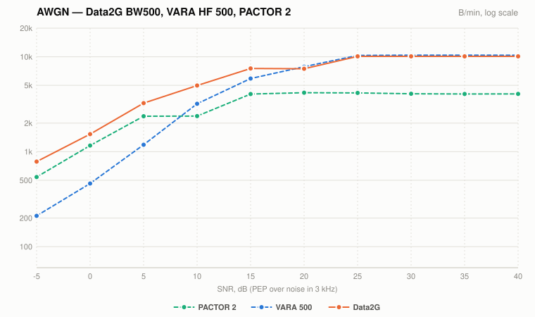
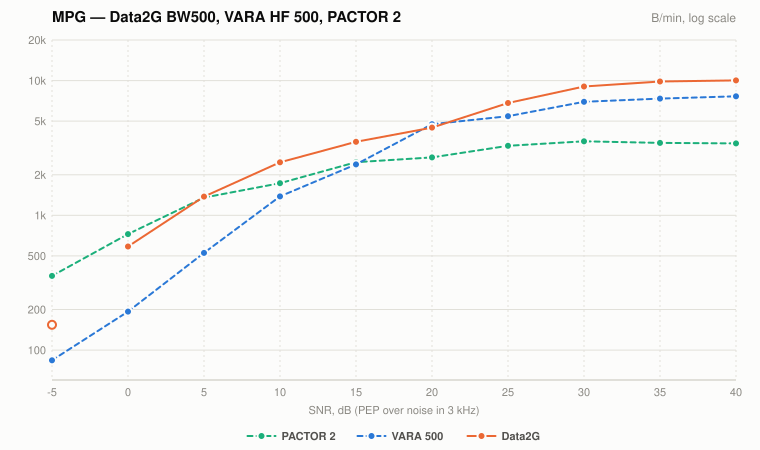
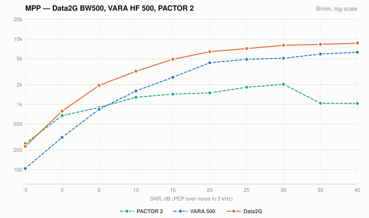

# Data2G and VARA HF 500 against the IONOS SIM paper

<!-- Generated by make_charts.py; edit the data there and re-run. -->

Payload throughput against SNR (PEP over noise in 3 kHz), mean of the middle 3
of 5 seeds.

- **Data2G** at its 500 Hz cap (BW500) is our speed test: the same channel
  model (`noise.py`, `channel.py`) simulated, with the host's turnaround
  latency.
- **VARA HF 500** (VARA 4.0) and **PACTOR 2** are the IONOS SIM paper's
  figures, from the March 2021 spreadsheet, HF 500 sheet, on WGN, MPG 2 and
  MPP 2.

The solid line is Data2G (simulated); dashed lines are the paper (IONOS SIM).
Hollow points average fewer than 5 good seeds and are left off the line. The
y axis is log scale: a horizontal gap between the lines is the same number of
dB at any rate.

AWGN is additive white Gaussian noise (the paper's WGN); MPG and MPP are CCIR
"good" and "poor" multipath, simulated with 2 rays (the paper's MPG 2 and
MPP 2).

### AWGN

### MPG

### MPP

## Notes

- Message sizes are the paper's VARA 500 sizes for each point (137,007 B at
  high SNR, down to 8,640 B), so Data2G and VARA include the same start-up
  share. PACTOR 2 used smaller files in the paper (69,311 B on WGN, 19,451 B
  on fading, down to 8,654 B), which costs it some rate to start-up.
- At −5 dB on MPG, 3 of 13 Data2G transfers completed: 9 were still running
  when the simulation's 1-hour limit stopped them (8,640 B at ~160 B/min takes
  about an hour) and 1 failed mid-transfer. It is shown hollow.
- At −5 dB on MPP, 5 of 6 Data2G transfers completed.

## Table

B/min. A count in brackets marks a Data2G figure averaged over fewer than 5
seeds.

| SNR | AWGN Data2G | AWGN VARA 500 | AWGN PACTOR 2 | MPG Data2G | MPG VARA 500 | MPG PACTOR 2 | MPP Data2G | MPP VARA 500 | MPP PACTOR 2 |
|---:|---:|---:|---:|---:|---:|---:|---:|---:|---:|
| 40 dB | 10,096 | 10,377 | 4,060 | 10,030 | 7,640 | 3,416 | 4,004 | 6,269 | 1,031 |
| 35 dB | 10,096 | 10,388 | 4,052 | 10,025 | 7,344 | 3,450 | 3,934 | 5,883 | 1,037 |
| 30 dB | 10,091 | 10,402 | 4,074 | 9,322 | 6,955 | 3,544 | 3,905 | 5,072 | 2,028 |
| 25 dB | 10,065 | 10,322 | 4,163 | 7,096 | 5,443 | 3,283 | 4,002 | 4,897 | 1,825 |
| 20 dB | 7,557 | 7,853 | 4,183 | 5,607 | 4,749 | 2,691 | 3,808 | 4,336 | 1,497 |
| 15 dB | 7,269 | 5,897 | 4,049 | 4,053 | 2,389 | 2,480 | 3,352 | 2,590 | 1,432 |
| 10 dB | 4,972 | 3,199 | 2,372 | 2,632 | 1,382 | 1,731 | 2,935 | 1,601 | 1,282 |
| 5 dB | 3,076 | 1,183 | 2,362 | 1,517 | 526 | 1,353 | 1,893 | 839 | 894 |
| 0 dB | 1,454 | 462 | 1,161 | 515 | 193 | 726 | 673 | 312 | 672 |
| -5 dB | 329 | 211 | 541 | 162 (3) | 84 | 355 | 238 | 104 | 250 |
