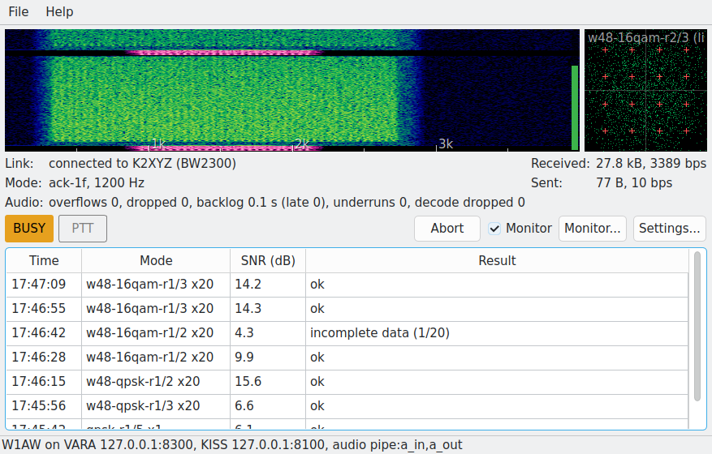
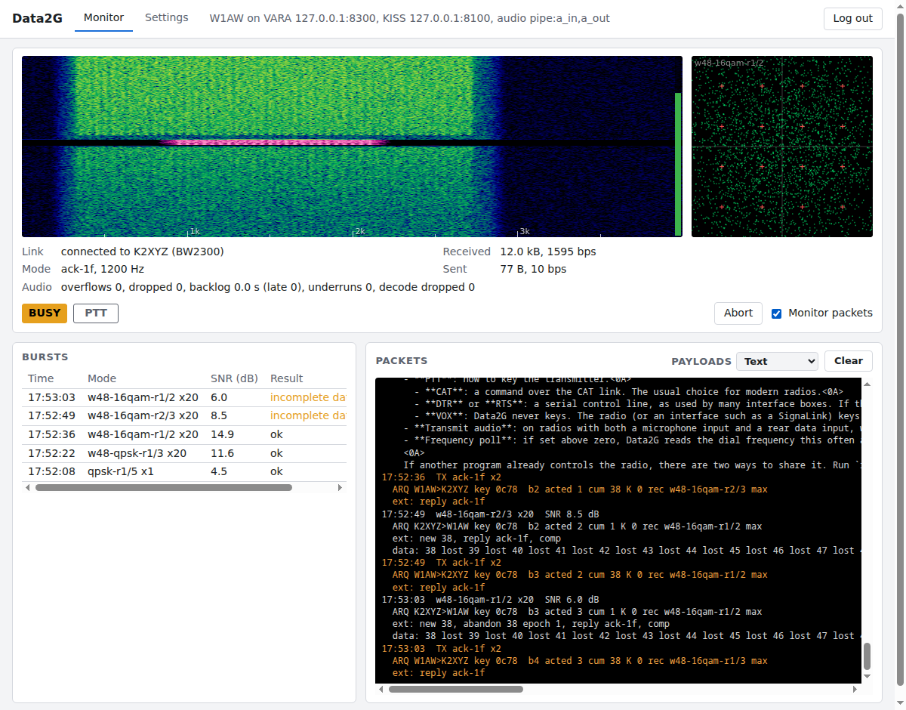
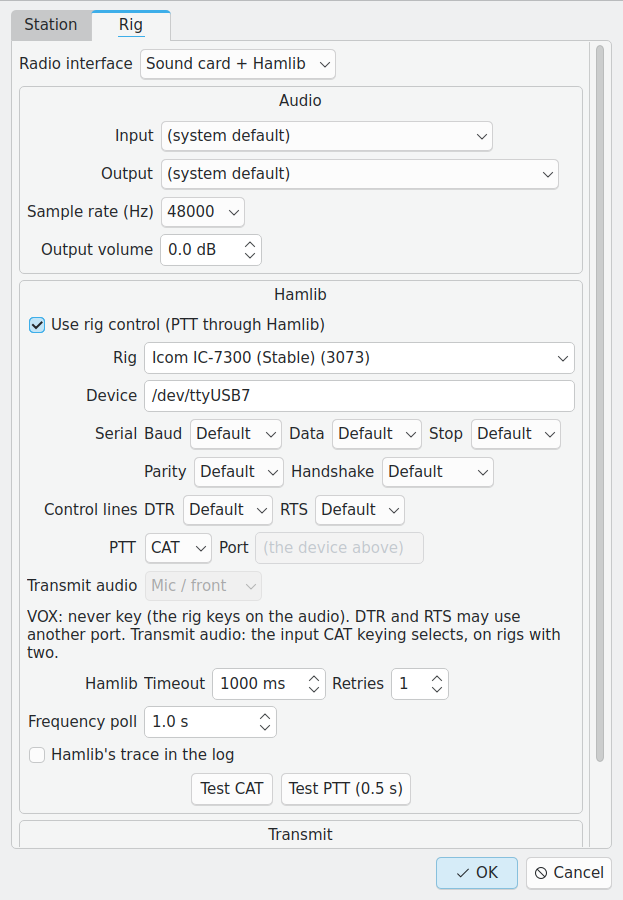
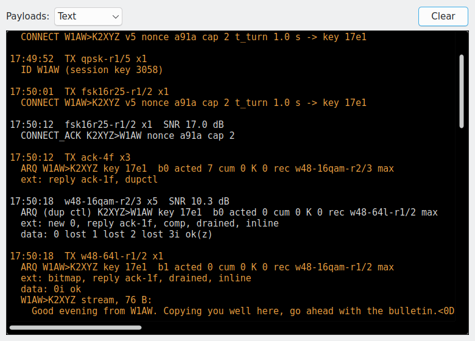
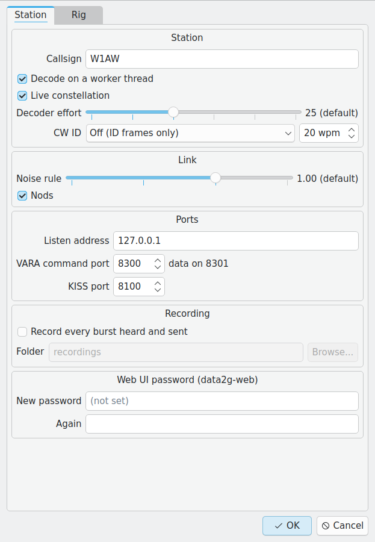
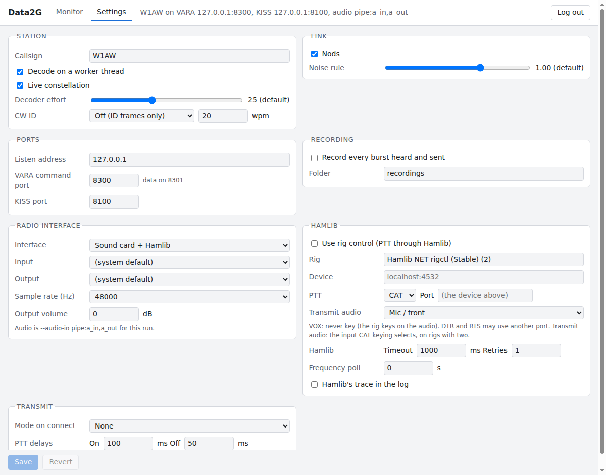

# Data2G User's Guide

For Data2G 0.5.0.

Data2G is a data modem for HF amateur radio. It turns the audio going in and out of your SSB transceiver into a reliable data link, so that other programs can chat, send email, or move files over the air. It is free, open source, and has no speed restrictions.

This guide assumes you know your way around an HF station. It doesn't assume you have used digital modes before.

## Contents

1. [What Data2G is, and what it isn't](#1-what-data2g-is-and-what-it-isnt)
2. [Installing](#2-installing)
3. [Running Data2G: three front ends](#3-running-data2g-three-front-ends)
4. [Connecting to your radio](#4-connecting-to-your-radio)
5. [Connecting applications](#5-connecting-applications)
6. [How the modem works](#6-how-the-modem-works)
7. [A tour of the screen](#7-a-tour-of-the-screen)
8. [Settings reference](#8-settings-reference)
9. [Monitoring the band](#9-monitoring-the-band)
10. [Raspberry Pi](#10-raspberry-pi)
11. [Troubleshooting](#11-troubleshooting)
12. [Getting help](#12-getting-help)
13. [Glossary](#13-glossary)

## 1. What Data2G is, and what it isn't

Data2G is a modem. It does one job: it carries bytes between two stations (or from one station to many), as fast as the band allows, and it makes sure they arrive intact.

On its own it doesn't do anything you can see. There is no chat window and no mailbox. Those come from separate applications that connect to Data2G over your computer's network and ask it to carry their data. A typical station looks like this:

```
  chat or email app  <-- TCP -->  Data2G  <-- audio + PTT -->  radio  <-->  antenna
```

So getting on the air takes three things:

1. Data2G installed and running (sections 2 and 3).
2. Data2G talking to your radio: receive audio, transmit audio, and a way to key the transmitter (section 4).
3. At least one application talking to Data2G (section 5).

Two things to know before you start:

- Both ends of a contact need Data2G. It speaks the same application interface as the VARA HF modem, so many programs written for VARA work with it, but the signal on the air is its own. A Data2G station can't connect to a VARA station.
- Data2G is beta software. It has been tested on the air and works, but the on-air protocol can still change between releases. If you can't connect to someone, check that you are both running the same version. Don't rely on it for anything safety-related.

### Applications known to work

| Application | What it does |
|---|---|
| [Ragtime](https://github.com/baitisj/ragtime) | Chat written for Data2G: broadcast and connected messaging, file transfer. |
| [PixelQSO](https://github.com/tcarwash/pixelqso) | Collectable pixel-art QSO cards. |
| [Pat](https://github.com/la5nta/pat) | Winlink email. Configure it as VARA HF. Peer-to-peer works. There are no Winlink gateways running Data2G yet. |
| [VarAC](https://www.varac-hamradio.com/) | Chat written for VARA. Works with a few glitches. Move away from its default calling frequencies so that you don't interfere with VARA users. |

Anything that can use a KISS TNC over TCP, such as an APRS client, can also use Data2G's KISS port.

## 2. Installing

Downloads are on the [Releases page](https://github.com/arodland/Data2G/releases/latest). Each release has a table with one row per platform. Every download contains the same set of programs: the GUI, the web UI, the headless host, and two small tools (`data2g-monitor` and `data2g-audio-check`).

### What you need

- A 64-bit computer. Most Intel or AMD PCs and every Apple Silicon Mac have plenty of power.
- A Raspberry Pi 5 runs Data2G comfortably. A Raspberry Pi 4 works if it isn't doing much else, with a small loss of sensitivity and slightly slower replies at the highest speeds. The Pi must run a 64-bit OS.
- An SSB transceiver, a sound interface between it and the computer (built into many modern radios), and a way to key it: CAT control, a serial control line, or VOX.

### Windows

Download one of:

- `data2g-0.5.0-windows-x64-setup.exe`: the installer. It installs to `C:\Program Files\Data2G`, adds a Start Menu entry, and can add a desktop shortcut. It needs administrator rights.
- `data2g-0.5.0-windows-x64-portable.zip`: no installation. Unzip it anywhere and run `data2g-gui.exe`.

The Start Menu entry opens the GUI. The other programs (`data2g-host.exe`, `data2g-web.exe`) are in the same folder and are run from a Command Prompt or PowerShell window.

### macOS

Download the `.dmg` for your Mac:

- `data2g-0.5.0-macos-arm64.dmg` for Apple Silicon (M1 and later).
- `data2g-0.5.0-macos-x86_64.dmg` for Intel Macs.

Open it and drag Data2G to Applications. The first time Data2G opens the sound card, macOS asks for permission to use the microphone. Say yes: that is how Data2G hears your radio.

The command-line programs live inside the app bundle:

```
/Applications/Data2G.app/Contents/MacOS/data2g-host --help
/Applications/Data2G.app/Contents/MacOS/data2g-web
```

### Linux (PC and Raspberry Pi)

Download the AppImage for your machine:

- `data2g-0.5.0-linux-x86_64.AppImage` for Intel and AMD PCs.
- `data2g-0.5.0-linux-aarch64.AppImage` for 64-bit ARM, including the Raspberry Pi 4 and 5.

Make it executable and run it:

```
chmod +x data2g-0.5.0-linux-x86_64.AppImage
./data2g-0.5.0-linux-x86_64.AppImage
```

With no arguments the AppImage opens the GUI. Put `host` or `web` first to run one of the other front ends:

```
./data2g-0.5.0-linux-x86_64.AppImage host --help
./data2g-0.5.0-linux-x86_64.AppImage web
```

There is also a `.tar.gz` for each architecture. Unpack it and run the `data2g` launcher inside, which takes the same `host` and `web` arguments.

Notes for Linux:

- The builds need glibc 2.39 or newer. That means Ubuntu 24.04, Debian 13, Fedora 40, or anything later.
- If the AppImage complains about FUSE, use the `.tar.gz`, or add `--appimage-extract-and-run` after the AppImage's name.
- To use a serial port for CAT or PTT, your user must be allowed to open it. On most distributions that means being in the `dialout` group (`uucp` on Arch): `sudo usermod -aG dialout $USER`, then log out and back in.

## 3. Running Data2G: three front ends

Data2G comes as three programs. All three contain the same modem and behave the same on the air. They differ only in how you watch and control it.

| Program | What you get | Use it when |
|---|---|---|
| `data2g-gui` | A desktop window: waterfall, status, burst log, monitor, settings dialog. | The radio's computer has a screen. This is the place to start. |
| `data2g-web` | The same display and settings as a web page, protected by a password. | The radio's computer is in another room, or is a Pi with no monitor, and you want to watch from a browser or a phone. |
| `data2g-host` | No display at all. Configured by command-line flags, reports to a log. | An unattended station, or a service that starts at boot. |

Run one of them at a time. They all want the same sound card and the same network ports, so a second one fails to start.

### One set of settings

All three read the same settings file. Whatever you save in the GUI or the web UI is what the others use the next time they start. A convenient way to set up a headless station is to configure it once with the GUI or web UI, then run `data2g-host` with no flags at all.

Any front end also accepts the host's command-line flags. A flag overrides the saved setting for that run only and is not saved. `--config FILE` uses a different settings file, which is handy if one computer runs two radios.

The settings file is `data2g.conf`, in:

| Platform | Folder |
|---|---|
| Windows | `%LOCALAPPDATA%\Data2G` |
| macOS | `~/Library/Preferences/Data2G` |
| Linux | `~/.config/Data2G` |

### The GUI



Start it from the Start Menu, the Applications folder, or the AppImage. The first time, open **Settings...** and enter your callsign and your radio's details (section 4). Section 7 explains what is on the screen.

### The web UI



Start `data2g-web`. From a terminal, the first run asks you to choose a password. Then open `http://127.0.0.1:8400/` in a browser on the same machine and log in.

To reach the page from another computer or a phone, tell it to listen on the network:

```
data2g-web --web-listen 0.0.0.0
```

and browse to `http://<the radio computer's address>:8400/`. `--web-port` changes the port.

About the password:

- The page stays locked until a password is set. Set or change it with `data2g-web --set-password` (this works while `data2g-web` is running), or in the GUI under Settings, Station, **Web UI password**.
- Changing the password logs out every browser.
- The connection is not encrypted. Use `--web-listen 0.0.0.0` only on a network you trust, such as your home LAN. Don't expose it to the internet.

### The headless host

`data2g-host` takes everything from the settings file and the command line. `data2g-host --help` lists every flag. Three flags print a list and exit, and are useful when setting up:

```
data2g-host --list-audio-devices     # sound cards, by number and name
data2g-host --list-rigs              # radio models Data2G can control
data2g-host --list-modes             # every submode (section 6)
```

A complete command line for a radio with a USB sound card and CAT on a serial port might be:

```
data2g-host --mycall W1AW --input-device USB --output-device USB \
            --rig-model 3073 --rig-device /dev/ttyUSB0
```

`--input-device` and `--output-device` take a number from the list or any part of the device's name. Stop the host with Ctrl+C. It unkeys the radio on the way out.

## 4. Connecting to your radio

Data2G needs three connections to the radio: audio from the receiver, audio to the transmitter, and a way to switch between receive and transmit (PTT). In the GUI these are all on the **Rig** tab of the settings dialog. The web UI has the same fields on its Settings tab.



Start with **Radio interface**. The most common configuration is **Sound card + Hamlib**. **TCI** is for SDR radios whose software offers a TCI server (see below).

### Audio

- **Input**: the sound device that carries the radio's receive audio.
- **Output**: the sound device that feeds the radio's transmit audio.
- **Sample rate**: leave it at 48000 unless your device needs something else.
- **Output volume**: Data2G's transmit level in dB. At 0 dB, the loudest peak of each transmission is at the sound card's full scale. Lower it to bring your radio's drive down, or if your sound card distorts when driven to full scale.

For a radio with a built-in USB sound card, both devices usually have "USB Audio" in their names. Pick the radio's device for both, not your computer's speakers and microphone.

### Rig control and PTT

Data2G uses the Hamlib library, which is built in, to control the radio. You don't need to install anything else.

- **Use rig control**: untick this if Data2G should never key the radio. That suits a receive-only monitoring station. It also suits the less common setup where the client application keys the radio itself: Data2G tells the application when to key and unkey, and the application does it.
- **Rig**: your radio model. Start typing the model number ("7300") to search the list.
- **Device**: the serial port the radio's CAT interface appears as (`COM5`, `/dev/ttyUSB0`), or `host:port` for a networked rig.
- **Serial**: baud rate and line settings. "Default" uses the usual values for the model. If CAT doesn't respond, set the baud rate to match the radio's menu.
- **PTT**: how to key the transmitter.
  - **CAT**: a command over the CAT link. The usual choice for modern radios.
  - **DTR** or **RTS**: a serial control line, as used by many interface boxes. If the line is on a different serial port from CAT, enter it under **Port**.
  - **VOX**: Data2G never keys. The radio (or an interface such as a SignaLink) keys itself when it hears transmit audio.
- **Transmit audio**: on radios with both a microphone input and a rear data input, which one a CAT key-up selects.
- **Frequency poll**: if set above zero, Data2G reads the dial frequency this often and shows it in the main window. It is only for display.

If another program already controls the radio, there are two ways to share it. Run `rigctld` (Hamlib's network daemon) and choose the rig **Hamlib NET rigctl** (model 2) in Data2G, with the device left empty for `localhost:4532`. This is the default rig on a fresh install. Or let the other program own the radio and set Data2G's PTT to VOX.

The **Test CAT** button connects to the radio and reports its dial frequency. **Test PTT** keys the transmitter for half a second. Both act on the real radio at once, so have it on a dummy load or a clear frequency. If the modem is already running and using the same serial port, the test may report that the port is busy.

### Transmit options

- **Mode on connect**: Data2G can put the radio in USB or its data mode (USB-D, DIGU, PKT) when it starts. "None" leaves the radio as you set it.
- **PTT delays**: how long to wait after keying before sending audio (**On**, 100 ms by default) and how long to hold the key after the audio ends (**Off**, 50 ms). Raise the On delay if your radio or amplifier is slow to switch and the start of each transmission is cut off.

### TCI

Software-defined radios driven by ExpertSDR, Thetis, AetherSDR and similar programs can offer a TCI server. TCI carries audio, PTT and the dial frequency over one network connection, so no sound card or CAT setup is needed. Choose **TCI** as the radio interface and enter the server's address (the default is `localhost:50001`). The sample rate must be 8000, 24000 or 48000.

### Setting up the radio itself

- Use upper sideband, or your radio's USB data mode.
- Open the filters. Full-speed modes use audio from about 350 to 2700 Hz. A receive or transmit filter narrower than that will slow you down or stop the wide modes working at all. A 500 Hz session sits between about 1250 and 1800 Hz.
- Turn off speech processing, transmit equalisation, noise reduction, noise blankers and notch filters for the data input. They are built for voice and damage data signals.
- Set the transmit level so that the radio reaches the power you want with little or no ALC action. Overdriving makes your signal wider and harder to decode, not stronger.
- Set the receive level using the meter on the right edge of the waterfall (section 7). Band noise should sit well up the bar in the green, and **CLIP** should never appear.
- Data2G transmissions can be long and close to full power for their whole length. Respect your radio's duty cycle rating. Many 100 W radios are happier at 30 to 50 W on data.

### Your callsign

Enter it under Settings, Station, **Callsign**. Most applications also send their own callsign to Data2G when they connect, and that takes over while they are connected.

## 5. Connecting applications

Applications talk to Data2G over TCP. There are two interfaces.

| Interface | Default port | For |
|---|---|---|
| Command and data (VARA-compatible) | 8300 and 8301 | Connected sessions: one station to one station, with guaranteed delivery. Email, file transfer, keyboard chat. |
| KISS | 8100 | Broadcast: unconnected packets that anyone can hear. APRS, nets, group chat. |

These are the same port numbers the VARA HF modem uses. An application set up for "VARA HF" on the same computer will normally find Data2G with no changes. Data2G reports itself as a registered copy, so applications that reduce their features for unregistered VARA don't.

In the application's VARA or modem settings:

- Host: `127.0.0.1` or `localhost`.
- Command port: `8300`. The data port is always the command port plus one, so `8301`.
- KISS port, if the application uses it: `8100`.
- PTT: let Data2G key the radio. If the application has its own "PTT via modem" or "key the rig myself" choice, turn its own keying off unless you have set Data2G to not control the rig.
- Bandwidth: the application chooses 500 Hz or 2300/2750 Hz for each session. Choose 500 Hz when you are in a narrow-band segment of the band plan. Data2G then stays inside 500 Hz for that session.

As an example, Pat's `varahf` section looks like this at the time of writing:

```json
"varahf": {
  "addr": "localhost:8300",
  "bandwidth": 2300,
  "rig": "",
  "ptt_ctrl": false
}
```

### Using different ports

If something else on the computer already uses these ports (VARA itself, for example), change Data2G's under Settings, Station, **Ports**, or with `--command-port` and `--kiss-port`. Then enter the same numbers in the application. Remember that the data port follows the command port: command port 8500 means data on 8501.

### Running the application on another computer

By default Data2G only accepts connections from the computer it runs on. To let an application on a laptop reach Data2G on the shack PC:

1. On the Data2G machine, set **Listen address** (Settings, Station, Ports) to `0.0.0.0`, which means "any network interface". From the command line this is `--listen 0.0.0.0`. You can also enter one specific address of the machine to listen on that network only.
2. If the machine has a firewall, allow incoming TCP on 8300, 8301 and 8100.
3. In the application, replace `127.0.0.1` with the Data2G machine's address, for example `192.168.1.40`.

The command, data and KISS ports have no password. Anyone who can reach them can transmit with your station. Open them only on a network you trust.

Changing the listen address or a port restarts the modem, which drops any session in progress.

## 6. How the modem works

You don't need this section to operate, but it explains what you will see and hear.

### Bursts and turns

Data2G is half duplex: stations take turns. Each transmission is a burst, lasting from under a second to about 12 seconds on most modes, and up to about 24 seconds on the slow FSK modes. A burst begins with a short preamble and header that tell the receiver which submode follows, then one or more codewords. A codeword is a block of data with its own error correction and its own checksum, so the receiver knows exactly which blocks arrived and which didn't.

### Connected operation

A connected session is a reliable link between two stations, like a phone call.

1. One station calls the other by callsign. If nothing comes back it tries again, moving to a slower and tougher mode for the retries.
2. Once connected, the two stations alternate bursts. Each burst carries data (if there is any to send) and an acknowledgment of what the other station just sent.
3. When neither side has data, the link goes quiet apart from a short keep-alive every 15 to 30 seconds. A link that carries no data for five minutes disconnects by itself.
4. Either side can disconnect. The **Abort** button drops the link at once without telling the other station, for when you need the frequency back immediately.

Everything sent in a session is delivered complete and in order, or the session ends with an error. Text is compressed automatically.

### Acknowledgments and resends

Every burst acknowledges the previous one, codeword by codeword. Only the codewords that failed are sent again.

A resend is not a plain copy. It carries different error-correction bits from the first attempt, and the receiver combines both attempts. Two damaged copies will often decode together when neither would alone. This is called hybrid ARQ, and it is the reason a "failed" burst is rarely wasted airtime.

On the slowest FSK modes even a minimal acknowledgment burst takes about five seconds. When a reply has nothing new to say beyond "got it, carry on", Data2G can send a nod instead: a short sequence of tones that only the two stations in the session can recognise. A nod takes about half the airtime of the shortest FSK reply. Nods are on by default.

If a whole burst goes unanswered, the sender repeats it, then falls back to smaller bursts and tougher modes, and finally to short probes every 10 seconds. If nothing is heard for 90 seconds, the link is declared lost.

### Broadcast operation

Broadcast packets go out once, to anyone listening. Data2G itself provides no acknowledgments and no resends for them, so delivery isn't guaranteed. Error correction still applies, and a packet that arrives damaged beyond repair is thrown away, never delivered wrong.

An application is free to build its own acknowledgments and repeats on top of broadcast, and some do. Ragtime, for example, can ask for the missing pieces of a broadcast file. If you know networking, connected mode is to broadcast as TCP is to UDP.

Applications use broadcast for things that are naturally one-to-many: calling CQ, position beacons, net traffic, group chat. An application can keep its traffic separate from other applications' by opening a named broadcast group. It can also choose which submode its packets use. The default is a slow, robust one.

Before a broadcast transmission, Data2G waits for the frequency to be clear. Broadcasts are held while a connected session is in progress.

### The gear shifter

HF conditions change by the minute. A mode that flies at noon may not get a single bit through at dusk. Data2G therefore picks a mode for every burst.

The choice is made by the receiving station, because it is the one that knows how well it is hearing. After each burst it measures the signal: how strong, how noisy, how fast it is fading. A small neural network, trained on thousands of simulated contacts, estimates how likely each submode is to get through under those conditions. The receiver recommends the mode that should deliver the most data, and the sender uses it for its next burst.

Things worth knowing:

- Each direction is chosen separately. If you run 100 W to a station running 5 W, you will send to them faster than they send to you.
- The shifter can jump straight to any mode. It doesn't have to climb through the ones in between.
- The bandwidth can change from burst to burst, up to the limit the session was opened with. Seeing narrow and wide bursts in the same session is normal.
- It learns as it goes. If a mode does better or worse on this particular path than predicted, later choices take that into account.
- Chat applications can ask for low delay instead of maximum throughput. The shifter then favours short bursts that are very likely to arrive first time.

### Reading a mode name

Data2G has 50 submodes. You never choose one yourself in a connected session, but their names appear in the burst log and the monitor, and they are easier to follow once you can read them. A name has up to three parts:

```
   w48 - 16qam - r3/4
    |      |       |
  width  modulation  code rate
```

**Width** is how much of the SSB passband the burst occupies.

| Prefix | Bandwidth | Notes |
|---|---|---|
| `n4-` | 200 Hz | The narrowest. Slow, but gets through weak or crowded conditions. |
| `n10-` | 500 Hz | Fits narrow-band segments. |
| (none) | 1200 Hz | |
| `w48-` | 2400 Hz | A full SSB channel. The fastest. |

**Modulation** is how the data is impressed on the signal. Denser modulation carries more bits at once but needs a cleaner signal.

| Name | Bits per symbol | Needs |
|---|---|---|
| `qpsk` | 2 | Works on weak signals. |
| `16qam` | 4 | A good signal. |
| `64l` | 6 | A strong, steady signal. |
| `256l` | 8 | An excellent signal. |
| `fsk8`, `fsk16`, `fsk32` | | The most robust of all: see below. |

The first four are OFDM modes: many slow carriers side by side, 4 of them in a 200 Hz burst and 48 in a 2400 Hz one. The "l" in `64l` and `256l` says that the constellation was optimised by machine instead of being the textbook square grid.

The `fsk` modes work differently. They send one tone at a time, like a faster, denser RTTY. Because there is only one tone, the transmitter runs at constant full power, and that makes them the modes that get through when nothing else does. The name gives the number of tones and the speed: `fsk16r25` uses 16 tones at 25 symbols per second. `fsk8r50` and `fsk16r25` fit in 500 Hz, and `fsk32r62` needs 2300 Hz.

**Code rate** is the share of the transmitted bits that are your data. The rest are error correction. `r1/5` is one part data to four parts protection: slow and very hard to break. `r5/6` is almost all data: fast and fragile.

A few short modes don't follow the pattern. `ack-1f`, `n10-ack-4f`, `polar-k96-f4` and their relatives are tiny, heavily protected bursts used for acknowledgments, polls and keep-alives when there is little or no data to carry. The number after `f` is their length, so `ack-1f` is the shortest reply there is.

In logs, a mode is followed by a count such as `x12`. That is the number of codewords in the burst.

To give a feel for the range, here are a few modes from slowest to fastest. Speeds are the raw rate while transmitting. Real throughput is lower, because of turnarounds and resends, and tops out at about 6400 bits per second.

| Mode | Width | Rate (bits/s) | Typical use |
|---|---|---|---|
| `fsk16r25-r1/3` | 500 Hz | about 30 | The floor. Signals well below the noise. |
| `n4-qpsk-r1/5` | 200 Hz | 51 | Very weak signals. |
| `n10-qpsk-r1/2` | 500 Hz | 333 | Poor conditions, or a fair 500 Hz channel. |
| `qpsk-r1/2` | 1200 Hz | 806 | Fair conditions. |
| `n10-256l-r3/4` | 500 Hz | 2067 | An excellent 500 Hz channel. |
| `w48-qpsk-r3/4` | 2400 Hz | 2444 | Moderate conditions. |
| `w48-16qam-r3/4` | 2400 Hz | 4944 | Good conditions. |
| `w48-256l-r5/8` | 2400 Hz | 8222 | The ceiling. Strong, stable signals. |

Why so many? Most modems have a ladder of a dozen or so modes ordered from slow to fast. Real HF paths don't line up that neatly. A steady weak signal, a strong signal with deep fast fading, and a signal with a noisy neighbour 400 Hz away each call for something different. Every one of the 50 is the best choice for some combination of signal strength, fading and available bandwidth. Any that weren't were removed. The gear shifter's job is to know which is which, so that you don't have to.

`data2g-host --list-modes` prints all of them.

### Identification

Data2G identifies your station for you. In a session it sends a short ID burst carrying your callsign at least every ten minutes and once more when the session ends. Any Data2G station listening can decode it. If you also want an ID that people without Data2G can copy, turn on **CW ID** in the settings to add your callsign in Morse.

Some licensing authorities require an identification that can be read without special software, such as CW. Knowing your own rules is your responsibility. If they require a CW ID, turn it on. It is off by default.

## 7. A tour of the screen

The GUI and the web UI show the same information, laid out a little differently. In the web UI everything below is on the **Monitor** tab.


The screenshots in this guide show two simulated stations, W1AW and K2XYZ, joined by a software channel with noise and fading. That is why the status bar reads `audio pipe:` where yours will name your sound devices. In the picture above, W1AW is receiving a file. The wide green bursts are K2XYZ's data, and the short pink ones are W1AW's own acknowledgments.

### Waterfall

The waterfall shows received audio from 0 to 4 kHz, left to right, with time running downward. The newest line is at the top. Tick marks along the bottom are every 500 Hz, labelled every 1 kHz.

- Signals you receive are drawn in blue through green and yellow to white as they get stronger.
- Your own transmissions are drawn in a purple and pink palette, so you can tell the two sides of a contact apart at a glance.
- A Data2G burst looks like a solid block: about 500 Hz wide around 1500 Hz for the narrow modes, and from about 350 to 2700 Hz for the widest. FSK modes show as a single tone hopping around inside its band.
- Right-click the waterfall to change its speed (1, 2, 5 or 10 lines per second). Slower is easier on a small computer, and on a slow network link in the web UI.

**Level meter.** The thin bar on the right edge of the waterfall is the receive audio level. Green is fine. Amber means you are close to the top. Red means the input is clipping, and the word **CLIP** appears and stays until you click it. Clipping distorts everything you receive, so turn the receive level down (the radio's audio output, or the sound card's input gain) until it stops.

### Constellation

The square plot beside the waterfall shows the last burst as the demodulator saw it. Each dot is one received symbol. On a clean signal the dots gather into tight clusters: 4 for QPSK, 16 for 16-QAM, and so on. As the signal gets worse the clusters smear and run together. It is a quick visual check on signal quality and on whether a signal is overdriven or distorted.

### Status lines

- **Link**: what the connected-mode side is doing: `listening`, `connecting to W1AW`, `connected to W1AW (BW2300)`, or `disconnecting from W1AW`. The BW figure is the bandwidth limit agreed for the session.
- **Mode**: the submode of the session's most recent burst and its width.
- **Received** and **Sent**: bytes delivered in each direction during this connection, and the current rate in bits per second.
- **Audio**: counters of audio problems (overflows, dropped, backlog, late, underruns, decode dropped). They should all stay at zero. If any counts up, the line turns red: the computer is failing to keep up, or the sound device is misbehaving. See Troubleshooting.
- **Dial**: the radio's frequency. Shown only when frequency polling is on, or when using TCI.

### BUSY and PTT indicators

- **BUSY** lights amber while Data2G hears a signal on the frequency. Data2G holds back new calls and broadcasts while it is lit, so that it doesn't transmit over someone. Connected applications see it too, and many refuse to start a call while the channel is busy.
- **PTT** lights red while Data2G is transmitting.

### Buttons

- **Abort** drops the current session immediately, with no disconnect handshake. The application is told the link is gone. The other station finds out when it stops hearing you.
- **Monitor** (a checkbox; **Monitor packets** in the web UI) turns packet monitoring on or off.
- **Monitor...** opens the monitor window. In the web UI the monitor is the **Packets** panel.
- **Settings...** opens the settings dialog. In the web UI it is the **Settings** tab.

### Burst log

The table at the bottom lists every burst Data2G detects, newest first, whether or not it was meant for you.

| Column | Meaning |
|---|---|
| Time | When the burst was heard, local time. |
| Mode | The submode and the number of codewords, for example `w48-16qam-r1/2 x8`. |
| SNR (dB) | The measured signal-to-noise ratio: peak envelope power over the noise in a 2500 Hz bandwidth. Negative numbers are normal for the slow modes. |
| Result | What became of it (below). |

| Result | Meaning |
|---|---|
| ok | Every codeword decoded. |
| incomplete data (5/8) | Some codewords decoded, here 5 of 8. In a session the missing ones are resent and combined with what was received. |
| undecoded | The burst was received, but nothing in it could be read. Either it was too damaged, or it belongs to someone else's session. |
| lost | The start of a burst was detected, but the rest couldn't be received. |

A scattering of "incomplete" results in a session is normal and healthy. It means the gear shifter is running close to the limit of what the channel can carry, which is where the best throughput is. Rows of "undecoded" while you are just listening are usually other people's contacts.

### Monitor

With monitoring on, Data2G decodes every burst it can hear and prints what is inside, for any station, not only bursts addressed to you. It works like the monitor window of a packet TNC. Monitoring keeps running whether or not the monitor window is open, so the scrollback is complete when you do open it.



Each burst gets an entry: the time, mode, size and SNR, then one or more lines saying what the burst was, then any data it carried. Your own transmissions are shown in orange and marked `TX`. Section 9 explains how to read the entries.

**Payloads** switches between showing data as text or as a hex dump. **Clear** empties the display.

Remember that connected sessions aren't private. Anyone running Data2G can read them, as the rules of amateur radio require.

### Status bar

The bottom line of the GUI window (the top bar in the web UI) shows your callsign, the ports Data2G is listening on, and the audio devices in use. If the modem couldn't start, it says "stopped" and why. The web UI also shows a red badge when the browser has lost contact with `data2g-web`.

## 8. Settings reference

The same settings appear in the GUI's settings dialog (tabs **Station** and **Rig**) and the web UI's **Settings** tab. Each has a matching command-line flag, listed by `data2g-host --help`. Radio settings are covered in section 4.



Some changes restart the modem, which drops any session in progress and disconnects applications. A red warning appears beside the OK or Save button when the changes you have made will do that. Callsign, output volume, PTT delays, decoder effort, noise rule, nods, CW ID, live constellation and recording all apply without a restart.

The web UI's Settings tab has the same fields on one page:



### Station

- **Callsign**: your station's callsign.
- **Decode on a worker thread**: leave on. It lets Data2G keep listening for new signals while it decodes a long burst.
- **Live constellation**: fills in the constellation plot while a burst is still arriving, at a small cost in CPU. Turn it off on a slow machine.
- **Decoder effort**: how hard the error-correction decoder works on each burst before giving up. Higher values recover slightly more in deep fades and take longer on bursts that fail anyway. The default is 25. On a slow machine such as a Raspberry Pi 4, try 15 or 20.
- **CW ID**: adds a Morse ID (`DE` and your callsign, on 1500 Hz) to the normal ID bursts, or sends it in their place. The box beside it sets the speed, from 15 to 40 words per minute.

### Link

- **Noise rule**: how cautious the gear shifter is about using parts of the passband where your receiver has recently heard interference. At 1.00, the default, a mode whose band has been noisy is treated as if the signal were weaker there. Slide it to 0 to turn the rule off. Most stations should leave it alone.
- **Nods**: on the slowest modes, lets a station answer with a nod, a very short reply, in place of a full acknowledgment burst (section 6). Leave it on. Turn it off if the log shows nods repeatedly going unheard, which unsteady audio timing at either station can cause. Turning it off at either station stops nods in both directions. A change takes effect at the next session.

### Ports

- **Listen address**: which network addresses the command, data and KISS ports accept connections on. `127.0.0.1` means this computer only. `0.0.0.0` means any (section 5).
- **VARA command port**: 8300 by default. The data port is always one higher.
- **KISS port**: 8100 by default.

### Recording

- **Record every burst heard and sent**: saves the received audio and a log of every burst to a timestamped folder under the folder you choose. Recordings are the most useful thing you can attach to a bug report. They grow steadily, so turn recording off when you don't need it.

### Web UI password

Sets the password `data2g-web` asks for. It is never displayed. Typing a new one replaces it.

### Command line only

A few options have no place in the dialogs. The ones an operator might want:

| Flag | What it does |
|---|---|
| `--kiss-bw 500` | Limits KISS and broadcast transmissions to 500 Hz modes. The default is 2400. |
| `--broadcast-mode MODE` | The submode for broadcast packets when the application doesn't choose one. The default is `qpsk-r1/5`, or `n10-qpsk-r1/5` with `--kiss-bw 500`. |
| `--kiss-busy-limit S` | A broadcast held back by a busy channel is sent anyway after this many seconds. The default is 60. |
| `--dd-budget S` | Time allowed per burst for an extra decoding pass that tracks fast fading. The default is 1 second. Lower it, down to 0, on a slow machine. |
| `--threads N` | CPU threads used for decoding. |
| `--log-level DEBUG` | A much more detailed log. |
| `--config FILE` | Use a different settings file. |

## 9. Monitoring the band

Data2G's protocol is open, and any station can follow the traffic it hears. This is useful for seeing who is active, for checking how your own signal is being received at a second station, and for learning how the protocol behaves.

There are two ways to monitor.

- **On a working station**, tick **Monitor** in the GUI or **Monitor packets** in the web UI (section 7). Your station carries on as normal, and the monitor shows both sides of your own sessions as well as everyone else's.
- **On a receive-only setup**, run `data2g-monitor`. It has no transmitter, no rig control and no network ports. It listens to a sound card and prints what it decodes. It is the safe choice for a spare receiver or an SDR.

You can also make the full GUI receive-only by unticking **Use rig control**. It then can't key a radio, and you keep the waterfall and burst log.

### data2g-monitor

```
data2g-monitor --list-audio-devices
data2g-monitor --input-device USB
data2g-monitor --input-device USB --hex > heard.txt
```

| Flag | Meaning |
|---|---|
| `--input-device` | The sound device to listen on: a number from the list, or part of its name. The default is the system's default input. |
| `--sample-rate` | The device's sample rate. The default is 48000. |
| `--hex` | Show data as a hex dump. The default is text. |
| `--input-file` | Decode a file of raw audio (32-bit float, mono, 8000 samples per second) in place of a sound card. `-` reads standard input. |

The output is the same as the monitor window's, so it can be redirected to a file or piped into another program.

### Reading the monitor

Here is the start of a session, as W1AW's own monitor showed it:

```
17:50:01  TX fsk16r25-r1/2 x1
  CONNECT W1AW>K2XYZ v5 nonce a91a cap 2 t_turn 1.0 s -> key 17e1

17:50:12  fsk16r25-r1/2 x1  SNR 17.0 dB
  CONNECT_ACK K2XYZ>W1AW nonce a91a cap 2

17:50:18  w48-16qam-r2/3 x5  SNR 10.3 dB
  ARQ (dup ctl) K2XYZ>W1AW key 17e1  b0 acted 0 cum 0 K 0 rec w48-64l-r1/2 max
  ext: new 0, reply ack-1f, comp, drained, inline
  data: 0 lost 1 lost 2 lost 3i ok(z)

17:50:18  TX w48-64l-r1/2 x1
  ARQ W1AW>K2XYZ key 17e1  b1 acted 0 cum 0 K 0 rec w48-16qam-r1/2 max
  ext: bitmap, reply ack-1f, drained, inline
  data: 0i ok
  W1AW>K2XYZ stream, 76 B:
    Good evening from W1AW. Copying you well here, go ahead with the bulletin.<0D><0A>
```

The first line of each entry is the time, the submode, the number of codewords, and the SNR. `TX` marks your own transmissions, which have no SNR. A first line ending in `(nod ...)` is a nod, sent or heard, with what it stood for. The lines below say what the burst was:

| Line starts with | Meaning |
|---|---|
| `CONNECT a>b` | Station a is calling station b. `cap` is the bandwidth limit asked for: 0 for 500 Hz, 1 for 1200 Hz, 2 for 2400 Hz. |
| `CONNECT_ACK`, `CONNECT_NAK` | The call was accepted or refused. |
| `ARQ a>b` | A burst within a session, from a to b. |
| `POLL a>b` | A short burst asking the other station to repeat its last acknowledgment. |
| `DISC`, `DISC_ACK` | The session is closing. |
| `ID call` | A station identifying. |
| `CQ call` | A station calling CQ. |
| `BCAST "group"` | Broadcast packets, with the group they were sent to and how many arrived. |
| `unidentified` | Nothing in the burst could be checked. Either none of it decoded, or it belongs to a session whose start the monitor didn't hear. |
| `header only: burst lost` | The start of a burst was detected and the rest was not received. |

An `ARQ` line carries the bookkeeping of the link. The parts worth knowing:

- `key 17e1` identifies the session. Every burst of one session has the same key, which is how the monitor tells sessions apart.
- `b0`, `b1` and so on number the bursts.
- `cum` is the acknowledgment: every codeword numbered below it has been received.
- `rec w48-64l-r1/2 max` is the gear shifter at work. It is the mode this station recommends for the other station's next burst, and a hint about burst size: `shrink`, `hold`, `grow` or `max`.
- `reply-lost` means the station didn't hear the answer to its previous burst.

A `data:` line lists the data codewords in the burst by number, each followed by what became of it: `ok`, `ok(z)` for compressed data, `lost`, or `had` for a resend of something already received. In the example, K2XYZ's first burst arrived with three of its four data codewords lost. They were resent in the following bursts.

Lines ending in `stream, 76 B:` show the session's data, reassembled in order, followed by the data itself. In text view, bytes that aren't printable are shown in angle brackets, such as `<0D><0A>` for the end of a line.

The monitor learns who is in a session by hearing its CONNECT or an ID. If you tune in halfway through, callsigns show as `?` until one of the stations identifies, and data you didn't hear the start of may not be readable.

### Checking the sound path

`data2g-audio-check` tests a sound device without going on the air. Run with no arguments, it lists the input and output devices. With `--loop`, it plays a tone out of one device and measures it coming back in another, through the same audio code the modem uses:

```
data2g-audio-check --loop --in USB --out USB
```

This needs the output wired back to the input, for example with a loopback cable. It reports how cleanly the tone came back and whether any audio was lost on the way. Use it when you suspect the sound device of causing the audio counters to climb.

## 10. Raspberry Pi

A Raspberry Pi makes a good small station computer, and a Pi at the radio with the display in a browser somewhere else is one of the setups Data2G is built for.

### What to expect

- **Pi 5**: runs everything, including the GUI, with room to spare.
- **Pi 4**: works well if Data2G is its main job. It is the slowest machine Data2G is regularly tested on. Expect slightly less sensitivity in fast fading, and slower replies on the very fastest modes.

Listening is not the problem. On a Pi 4, searching for signals takes about half of one of its four cores. The hard part is decoding. When a long burst in one of the fastest modes ends, the Pi has about a second to decode it and start its reply. The largest bursts can take longer than that. When the reply is late the other station asks again, and throughput suffers. The settings below all trade a little decoding strength for time.

### Installing

- Use a 64-bit Raspberry Pi OS based on Debian 13 ("Trixie") or newer. `uname -m` should print `aarch64`.
- Download the `linux-aarch64` AppImage (section 2).
- Add your user to the `dialout` group if you use a serial port.

For a Pi with no screen, run the web UI and do everything else from a browser:

```
./data2g-0.5.0-linux-aarch64.AppImage web --web-listen 0.0.0.0
```

The first run asks for a password. Then open `http://<the Pi's address>:8400/` from another computer and set up the radio on the Settings tab. Once it is configured you can keep using the web UI, or switch to `host` for the lowest overhead.

To let applications on other computers use the Pi's modem, also set the listen address to `0.0.0.0` (section 5).

### Tuning a Pi 4

Try these in order, and stop when the audio counters stay at zero and fast links stop stalling. A Pi 5 shouldn't need any of them.

1. **Run headless.** Use `web` or `host` instead of the GUI. If you do run the GUI, right-click the waterfall and choose 1 or 2 fps, and turn off **Live constellation**.
2. **Lower Decoder effort** to 20, then 15.
3. **Lower the DD budget.** Start Data2G with `--dd-budget 0.5`, then `--dd-budget 0` if that isn't enough. This limits an extra decoding pass that helps in fast fading. At 0 you give up a decibel or two of sensitivity on fading signals.
4. **Try more threads.** Data2G uses two decoding threads on a four-core Pi. If the Pi does nothing else, `--threads 3` may shorten decode times.

Other things that matter on a Pi:

- **Cooling.** A Pi that gets hot slows itself down. Use a heatsink or a fan.
- **Power.** Use a proper power supply. A weak one also slows the Pi down, and causes USB audio dropouts.
- **Real-time audio.** At startup the log says either `real-time ... thread` three times, or `no real-time scheduling for the audio threads`. Without real-time scheduling, a busy Pi can leave gaps in your transmissions. Installing the `rtkit` package usually fixes it.
- **Other software.** Desktop file sync, browsers and SDR programs compete for the same four cores. Close what you don't need during a contact.

## 11. Troubleshooting

### Data2G says "stopped" or won't start

The status bar (or the host's log) gives the reason.

- **A port is already in use.** Another copy of Data2G is running, or VARA is. Close it, or change Data2G's ports (section 5).
- **An audio device wasn't found.** The device was unplugged or renamed. Choose it again in the settings. Saved devices that are missing are marked "(not found)".

A radio that can't be reached doesn't stop the modem. Data2G runs, receives, and logs the rig error, but can't key. See "The radio doesn't key" below.

### The waterfall is black, or the level meter doesn't move

- The wrong input device is selected. Pick the radio's sound device.
- The operating system is blocking audio capture. On macOS, allow Data2G under System Settings, Privacy & Security, Microphone. On Windows, check Settings, Privacy & security, Microphone, and allow desktop apps.
- The radio isn't sending audio to its USB or data output. Check the radio's menu for the data output level and source.

### CLIP keeps appearing

The receive audio is too hot. Lower the radio's data output level or the sound card's input gain until the meter stays out of the red on the strongest signals. Click **CLIP** to clear it.

### The radio doesn't key

- Use **Test CAT** first. If it fails, the model, serial port or baud rate is wrong, or another program has the serial port open. Only one program can use a serial port at a time.
- If Test CAT works but **Test PTT** doesn't key, the PTT method is wrong for your setup. Try CAT, then RTS or DTR.
- On Linux, "permission denied" on the serial port means your user isn't in the `dialout` group (section 2).
- If the rig is still set to **Hamlib NET rigctl**, the default, Data2G expects `rigctld` to be running. Choose your actual radio instead.
- Rig errors are written to the log as lines starting `rig:`. Run Data2G from a terminal to see them. Ticking **Hamlib's trace in the log** adds the full conversation with the radio.

### The radio keys but puts out little or no power

- The wrong output device is selected, and the audio is going to your speakers.
- The transmit audio level is too low. Raise the radio's data input gain, the sound card's output level, or Data2G's **Output volume**.
- On a radio with separate microphone and data inputs, **Transmit audio** is selecting the wrong one.

### Applications can't connect to Data2G

- Check that Data2G is running and not "stopped".
- Check that the port numbers match on both sides, and that the application's data port is the command port plus one.
- From another computer: the listen address must be `0.0.0.0` (or that machine's own address), and the firewall must allow the ports (section 5).

### Nobody answers my calls

- The other station must be running Data2G, be listening, and be on the same dial frequency in USB.
- Check that both stations run the same Data2G version.
- Watch the waterfall while you call. If the frequency is in use, BUSY holds your call back.
- Check your own signal: listen on a second receiver or a web SDR, or ask the other station to turn on monitoring and tell you what they see.

### The link is slow

Look at the burst log first. The SNR column and the modes being chosen tell you most of what you need.

- **Low SNR, robust modes.** That is simply the band. Data2G is already doing what it can.
- **Only 500 Hz modes.** The session was opened at 500 Hz. Change the bandwidth in the application if the band plan allows a wide signal.
- **Wide modes never appear, or always fail.** A filter is cutting the edges of the signal at one end or the other. Open receive and transmit filters to at least 2.7 kHz.
- **A strong signal that won't climb.** If the other station's SNR is high on the FSK and ack modes but the fast modes fail, their transmit audio is probably overdriven. Ask them to turn it down until the ALC is quiet. Check yours as well.
- **A very weak link keeps stalling on the FSK modes.** If the monitor shows nods being sent and not answered, try turning **Nods** off. Turning it off at either station stops nods in both directions.
- **Audio counters are red.** See the next item.

### The Audio counters are counting up

The computer is not keeping up with real time, or the sound device is glitching. Occasional single counts when another program hogs the machine are harmless. Steady counting costs you throughput and can break links.

- Close other heavy programs.
- Lower **Decoder effort**, turn off **Live constellation**, and slow the waterfall down.
- On a Raspberry Pi, work through section 10.
- Try a different USB port for the sound device, and avoid unpowered hubs.

### Web UI problems

- **The page says to set a password.** Run `data2g-web --set-password` on the radio computer.
- **Forgotten password.** The same command sets a new one.
- **It works on the radio computer but not from elsewhere.** Start it with `--web-listen 0.0.0.0` and check the firewall for port 8400.
- **`data2g-web` won't start while the GUI is open.** Only one front end can run at a time.

### Linux: the AppImage does nothing

Check that it is executable (`chmod +x`). Run it from a terminal to see any error. If the error mentions FUSE, use the `.tar.gz` download or `--appimage-extract-and-run`. If it mentions GLIBC, your distribution is older than the builds support.

## 12. Getting help

- Chat with other users and the author on the [Digital Oddballs Radio Club Discord](https://discord.gg/JJgNszRMce).
- Report bugs on [GitHub](https://github.com/arodland/Data2G/issues).

A good report includes:

- The Data2G version (Help, About Data2G in the GUI) and your operating system.
- What you did, what you expected, and what happened.
- The log. Run from a terminal with `--log-level DEBUG` to capture one.
- For anything that happened on the air, a recording: turn on **Record every burst heard and sent**, reproduce the problem, and attach the folder it creates.

## 13. Glossary

| Term | Meaning |
|---|---|
| ACK | Acknowledgment. The receiving station's report of which codewords arrived. In Data2G every burst carries one. |
| ARQ | Automatic repeat request. The general name for protocols that resend whatever wasn't acknowledged. Data2G's connected mode is an ARQ protocol. |
| Bandwidth cap | The widest signal a session may use: 500, 1200 or 2400 Hz. The application sets it when it opens the session. |
| Broadcast | A transmission addressed to anyone listening, with no acknowledgment. |
| Broadcast group | A name that an application gives its broadcast traffic so that other applications can ignore it. |
| Burst | One transmission by one station, from key-down to key-up. |
| BUSY | Data2G's indication that it hears a signal on the frequency. |
| CAT | Computer control of a transceiver over a serial, USB or network link: frequency, mode, and usually PTT. |
| Code rate | The fraction of transmitted bits that are data, the rest being error correction. Written `r1/2`, `r3/4` and so on. |
| Codeword | A block of data with its own error correction and checksum. The unit that is acknowledged and resent. |
| Command port, data port | The two TCP ports of the VARA-compatible interface. Commands and status go over one, the session's data over the other. |
| Connected mode | A reliable two-station link with acknowledgments and resends. Also called a session. |
| Constellation | The pattern of points a modulation uses, and the plot of received symbols against it. |
| CW ID | Station identification sent in Morse code. |
| FEC | Forward error correction. Extra bits sent with the data that let the receiver repair errors without asking for a resend. |
| FSK | Frequency-shift keying. One tone at a time, chosen from a set. Data2G's most robust modes. |
| Gear shifter | The part of Data2G that chooses the submode for each burst from measured conditions. |
| Half duplex | Stations take turns transmitting. Neither can hear while it sends. |
| Hamlib | The open-source rig control library built into Data2G. |
| Hybrid ARQ | ARQ in which a resend carries new error-correction bits and is combined with the earlier attempt. |
| ID frame | A short burst carrying a station's callsign, sent automatically. |
| KISS | A simple, widely supported protocol between a packet radio program and a modem. Data2G offers it over TCP. |
| Listen address | The network address on which Data2G accepts connections from applications. |
| Modem | A device or program that turns data into a signal for a communication channel, and back. |
| OFDM | Orthogonal frequency-division multiplexing. Many slow carriers side by side. Most Data2G modes use it. |
| PEP | Peak envelope power. The power at the highest peaks of a signal, which is what transmitters and licence limits are rated in. |
| PTT | Push to talk. Switching the radio from receive to transmit. |
| QAM, QPSK | Modulations that encode bits in the phase and amplitude of a carrier. QPSK carries 2 bits per symbol, 16-QAM carries 4. |
| rigctld | Hamlib's network daemon. It lets several programs share control of one radio. |
| Session | One connected-mode contact, from connect to disconnect. |
| SNR | Signal-to-noise ratio, in decibels. Data2G reports peak signal power against the noise in 2500 Hz. |
| Submode | One of Data2G's 50 combinations of width, modulation and code rate. Usually just "mode". |
| TCI | A network protocol offered by some SDR software that carries audio, PTT and frequency over one connection. |
| TNC | Terminal node controller. The traditional name for a packet radio modem. |
| Turn | One station's burst in a session. Turns alternate. |
| USB | Upper sideband, when talking about the radio's mode. Also the computer connector, as in "USB sound card". |
| VARA | A widely used proprietary HF modem. Data2G is compatible with its application interface, not with its signal. |
| VOX | Voice-operated transmit. The radio keys itself when it hears audio. |
| Waterfall | A scrolling display of signal strength against frequency and time. |
